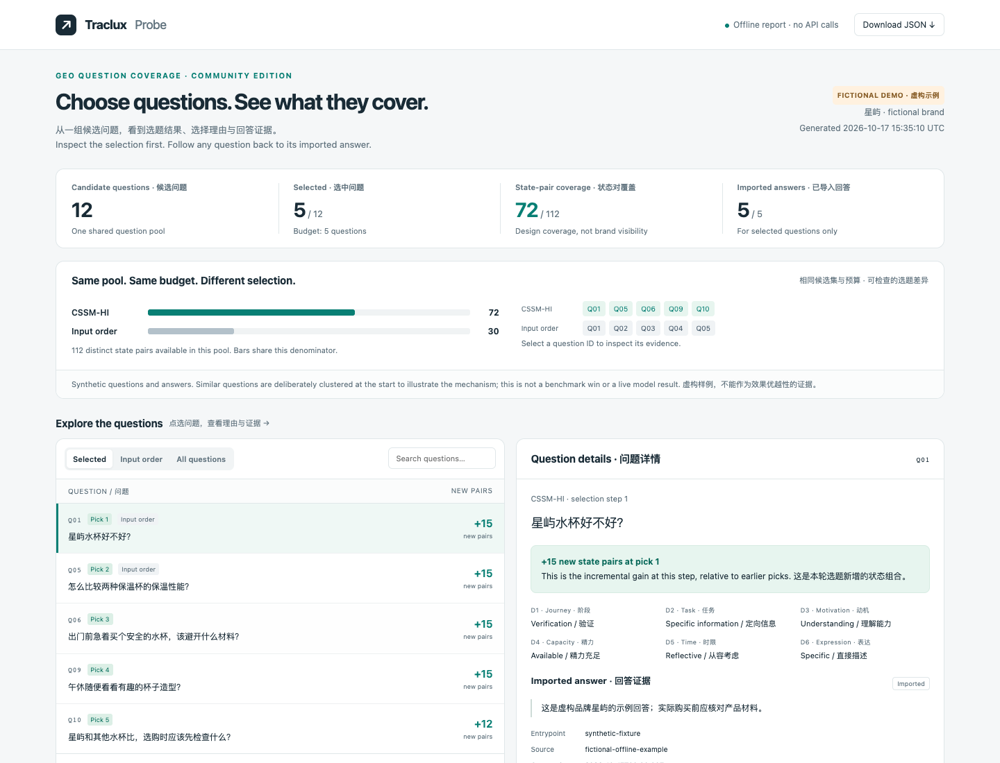

# Traclux Probe

**Choose questions for GEO tests. Inspect the selection. Keep the answer evidence.**

[中文说明](README.zh-CN.md) · [Live demo](https://zanelau.github.io/traclux-probe/demo/) · [Method](docs/methodology.md) · [Contributing](CONTRIBUTING.md)

Have a list of questions and a limited testing budget? Traclux Probe selects questions using six explicitly supplied state dimensions, shows which combinations they cover, and lets you inspect imported answers with their source and capture time.

**Python 3.9+ · zero dependencies · no account or API key · Apache-2.0**



The screenshot uses an invented brand, questions and answers. State-pair coverage is a design metric, not consumer visibility or evidence of better commercial outcomes.

## See it before you install anything

**[Open the interactive demo →](https://zanelau.github.io/traclux-probe/demo/)** No account, installation or API key needed.

You can also download this repository and open [`docs/demo/index.html`](docs/demo/index.html) in a browser. The file includes its data and works offline. GitHub's file viewer shows its source; download the file to run it. [Demo instructions and a short walkthrough →](docs/demo/README.md)

1. Compare the question IDs selected by CSSM-HI and input order.
2. Pick a question to inspect its incremental coverage and supplied labels.
3. Read its imported answer, entrypoint, source, capture time and citations. Missing answers stay missing.

## Reproduce the report

From the repository root:

```bash
python3 -m traclux_probe \
  --questions examples/fictional-brand/questions.json \
  --responses examples/fictional-brand/responses.json \
  --brand 星屿 --budget 5 \
  --output reports/example.json --html reports/example.html
```

Open `reports/example.html` in your browser. JSON remains available for your own analysis; `--html` is optional. No server, database, provider calls or package installation is needed to generate or open the report.

In this deliberately clustered fixture, the five selected questions cover **72 state pairs**, compared with **30** for the first five input questions. The shared pool contains 112 distinct pairs. The fixture illustrates the mechanism; it is **not a benchmark demonstrating algorithm superiority**.

## Bring your own questions

Put questions you have permission to use in a UTF-8 text file, one per line. The guided annotator asks you to confirm all six dimensions:

```bash
python3 -m traclux_probe annotate \
  --input examples/fictional-brand/raw-questions.txt \
  --output reports/my-questions.json
python3 -m traclux_probe --questions reports/my-questions.json \
  --budget 2 --output reports/my-report.json --html reports/my-report.html
```

Labels are supplied by the user. Word-matching suggestions are unvalidated hints, not inferred psychological truth. You can also supply [annotated JSON](examples/fictional-brand/questions.json) directly.

Answers are optional. Import captures you may lawfully save using the [response format](examples/fictional-brand/responses.json): `question_id`, `answer`, `citations`, `entrypoint`, timezone-aware `captured_at`, and `source`. The tool does not acquire answers. `--brand` performs illustrative literal matching in the JSON report.

**Sharing reports:** the HTML contains the full candidate pool and all imported answers, including those not selected, so its explorer works offline. The JSON download inside it preserves the CLI's selected-question report. Review either file before sharing it.

## What is open source?

The community version includes explicit six-dimensional states, compatibility checks, deterministic greedy pair-coverage selection, guided annotation, answer import, and offline JSON/HTML reports. It runs independently of the commercial product.

Commercial Traclux may separately provide licensed question sources, automatic domain mapping, ongoing multi-entrypoint sampling, calibration, hosting and team services. This repository is a standalone basic implementation, not the full Geo-Probe production engine.

Read the [method and limitations](docs/methodology.md), [license](LICENSE), [notice](NOTICE), [trademark policy](TRADEMARK.md) and [security policy](SECURITY.md). Historical benchmark preparation is documented [separately](docs/benchmark-sources.md) and is not required for the demo.

## Release

The first community release is **v0.1.0**. See the [changelog](CHANGELOG.md) and [GitHub releases](https://github.com/ZaneLau/traclux-probe/releases). This early release focuses on transparent, offline question selection; algorithm effectiveness on real demand remains unvalidated. Existing private backend, frontend and landing repositories are outside this repository.
