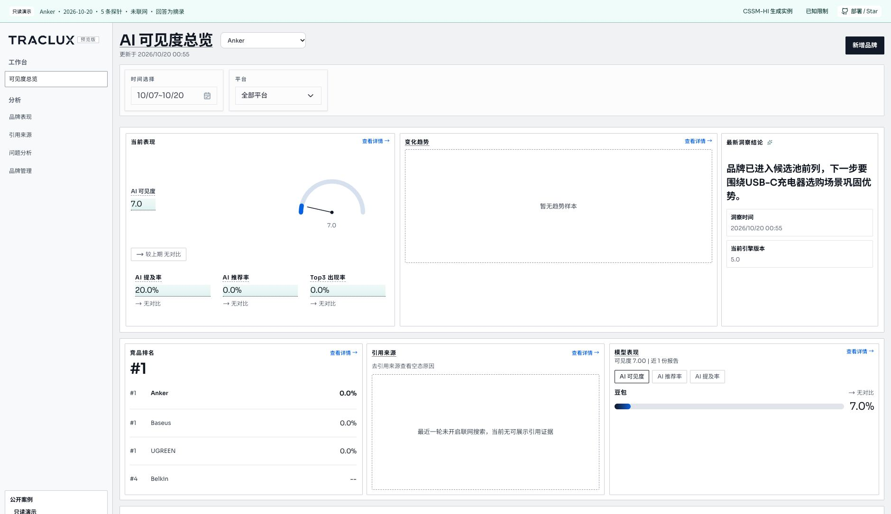
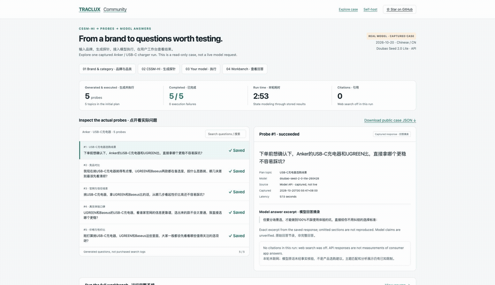

# Traclux · 探镜社区版

**用 CSSM-HI 生成探针，接入模型执行，在工作台查看和分析回答。**

[**免登录工作台演示**](https://zanelau.github.io/traclux-probe/demo/) · [English](README.md) · [启动与功能说明](docs/community/README.md) · [来源清单](docs/community/source-manifest.json) · [安全政策](SECURITY.md)

这是 **v0.2.0 社区预览版**，包含 Spring Boot 后端和 Nuxt 工作台，采用 Apache-2.0 许可。部署后接入自己的模型服务即可运行。

[](https://zanelau.github.io/traclux-probe/demo/)

先打开[只读工作台](https://zanelau.github.io/traclux-probe/demo/)，无需注册或 API Key，即可浏览这次案例的总览、品牌表现、问题记录与运行详情。生成新问题和运行完整工作台，请按下方说明部署。

## CSSM-HI 的特色：同一个品牌，不同状态的人会怎样问？

临下单的人、怕充坏设备的人、刚开始了解充电器的人，需要问的问题不一样。Traclux 先描述用户状态的**六个维度**，选择状态组合，再让模型生成自然问句。生成时用过哪些状态，可以和最后的问题一起查看。

```text
Anker · USB-C 充电器
  → 正在核对选择 + 想买到产品 + 担心设备安全
  → 有精力比较 + 急着用 + 按参数细节提问
  → “下单前想确认下，Anker的USB-C充电器和UGREEN比，直接拿哪个更稳不容易踩坑？”
  → 接入自己的模型执行 → 保存回答 → 在工作台查看
```

这是一次 Anker 运行中保存的问题和状态标签。标签描述生成目标，可以对照问句检查表达是否到位；例如这句没有明确说出“马上要用”。

| 状态 | 通俗含义 | 这条探针保存的实际标签 |
| --- | --- | --- |
| D1 · 决策阶段 | 已经了解到哪一步？ | 核对看中的 C 充靠不靠谱 |
| D2 · 目标 | 想完成什么？ | 就想赶紧买到合适的 C 充 |
| D3 · 动机 | 为什么在意？ | 要安全，别充坏设备 |
| D4 · 注意力 | 还能想多复杂？ | 思路清晰，可以比较 |
| D5 · 时间 | 有多着急？ | 急着用，马上要买到 |
| D6 · 交互 | 怎样提问？ | 对着参数详情挨个比对 |

**建议先点演示里的 [#1、#2、#5](https://zanelau.github.io/traclux-probe/demo/case-study/#explore)**：分别看看临下单确认、找比较方法、刚开始了解时的问题有何不同。右侧会一起切换实际状态标签和回答摘录，还能展开原始编码或[下载公开 JSON](docs/demo/case.json)。

[生成过程与源码导读](docs/community/generation-walkthrough.md)把固定状态、品类翻译、覆盖选点、问句生成与质量检查对应到具体代码。五条样例展示了生成过程，算法效果还需要对照实验评估。

演示只展示已保存的结果，不调用模型。生成新问题需要自行部署并配置模型服务，调用费用按服务商规则计算。

| 用户要做的事 | 开源内容 |
| --- | --- |
| 配置品牌 | 品牌识别、品牌空间、主题、固定问题及设置 |
| 生成探针方案 | CSSM-HI 状态建模、覆盖选点、问句生成、质量控制 |
| 执行探针 | 方案确认、手动执行、模型适配、回答保存及失败记录 |
| 分析结果 | 可见度总览、品牌表现、引用来源、问题分析、生成记录与回答来源 |
| 跟踪执行 | 运行进度、事件、历史批次与详情 |
| 独立部署 | 普通用户认证、数据访问隔离、MySQL、Redis、知识资产 PostgreSQL、Docker Compose |

自部署无需购买 Traclux 订阅。模型费用由服务商收取，本地用量限制见[启动说明](docs/community/README.md)。

## 本地启动

需要 Docker Compose 和 Python 3；构建使用 Java 21 和仓库锁定的 Nuxt 依赖。

```bash
git clone https://github.com/ZaneLau/traclux-probe.git
cd traclux-probe
python3 scripts/community_init.py
# 在 .env 中配置 MODEL_BASE_URL、MODEL_API_KEY、MODEL_NAME。
docker compose up --build -d
```

打开 [http://localhost:3100/login](http://localhost:3100/login)。用户名和随机密码见你自己生成的 `.env` 中的 `COMMUNITY_USERNAME` / `COMMUNITY_PASSWORD`。不要提交或分享此文件。首次运行前需要配置可用的模型地址。可用 `SAMPLING_*` 单独配置被测模型；具体适配限制见[启动说明](docs/community/README.md)。

```bash
python3 scripts/community_smoke.py
docker compose stop
```

检查脚本只验证登录、用户接口与管理接口不可用，不调用模型。社区配置默认关闭后台定时执行和供应商联网搜索；手动执行同样会消耗你自己的模型额度。

## 运行记录与已知问题

一个 Anker / USB-C 充电器案例完成了探针生成和模型执行，5 条回答全部保存，全程耗时 173 秒。登录、数据库初始化、总览、品牌表现和运行详情也已检查，详见[验证记录](docs/community/validation.md)。

这是早期版本，[已知限制](docs/community/known-limitations.md)包括问答分组展示、主题关联、汇总表达、手动重跑和调用计量。默认只监听本机，不应直接作为公开多用户服务；[安全检查记录](docs/community/security-review.md)逐项说明检查范围和剩余告警。

此案例未开启联网搜索，引用为 0。探针是合成问题；API 回答可能与客户端不同，这组小样本不适合用来判断品牌排名。



Python 选题器、虚构示例和[v0.1.0 历史演示](https://github.com/ZaneLau/traclux-probe/tree/v0.1.0/docs/demo)仍可用于研究早期的选题流程，详见[选题器方法说明](docs/methodology.md)。

项目代码采用 [Apache-2.0](LICENSE)，保留的前端模板、字体等第三方文件遵守各自许可证。问题反馈请提供对应页面、预期行为及脱敏复现，不附带密钥、会话、私有回答或数据库导出。

欢迎反馈部署体验和模型兼容情况。如果项目对你有帮助，欢迎 Star。
